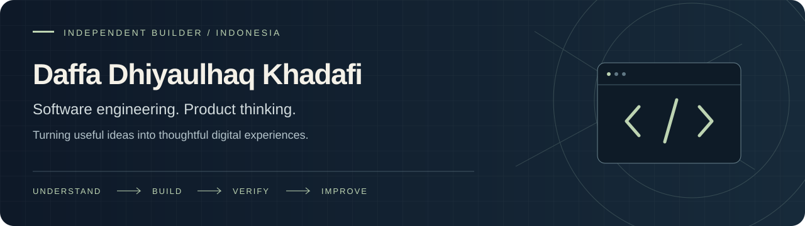

**Product-minded Software Engineer · Full-Stack Builder · Indonesia**

[Portfolio](https://khadafidaffa.com) &nbsp; / &nbsp; [Selected code](https://github.com/dhiyaulhaqkhadafi0?tab=repositories) &nbsp; / &nbsp; [Chikki](https://chikki.id) &nbsp; / &nbsp; [About & contact](https://khadafidaffa.com/about)

## Hi, I'm Khadafi.

I build digital products from the first user problem to the interface, server routes, data model, and deployment. My work combines **product thinking, UX, full-stack engineering, and AI-assisted development**.

I'm an independent builder based in Indonesia, exploring remote **Software Engineering and Product Engineering** opportunities. I enjoy working on useful products, understanding how their parts fit together, and improving them through testing and feedback.

## Selected work

| Project | Product & engineering focus | Explore |
| :--- | :--- | :--- |
| **Khadafi Digital Ecosystem** | A Next.js platform bringing publishing, learning resources, digital products, accounts, and commerce workflows together. | [Live](https://khadafidaffa.com) · [Code & architecture](https://github.com/dhiyaulhaqkhadafi0/website) |
| **Chikki — Immersive Writing Network** | A writing and reading product exploring creative publishing, reader experiences, and creator workflows. Application source is private. | [Product](https://chikki.id) |
| **SMMC Property** | Property discovery, mortgage scenarios, visual galleries, and inquiry journeys built with Next.js. | [Code & overview](https://github.com/dhiyaulhaqkhadafi0/Metland-Cikarang) |
| **Freelance Journey Hub** | Guides, curated tools, and career resources within the Khadafi platform. | [Explore the hub](https://khadafidaffa.com/freelance) |

## Engineering toolkit

| Layer | Tools I use |
| :--- | :--- |
| Interface | TypeScript, JavaScript, React, Next.js, CSS, responsive UI |
| Server & data | Node.js, API integrations, SQL, PostgreSQL, Supabase |
| Delivery | Git, Cloudflare Workers, OpenNext, verification scripts |
| Product craft | User journeys, prototyping, accessibility, debugging, documentation |

## How I approach a product

1. **Understand** the user, the problem, and the constraints.
2. **Shape** the journey, data boundaries, and smallest useful implementation.
3. **Build** the interface and supporting systems together.
4. **Verify** behavior, permissions, and failure paths before making release claims.
5. **Improve** through feedback and what the running product reveals.

I use AI coding tools to explore, implement, review, and iterate. I stay responsible for the decisions, testing, and result. I value clear explanations, practical tradeoffs, and honest documentation of what still needs work.

## Currently

- Improving my products' reliability, accessibility, and day-to-day usability.
- Deepening my understanding of full-stack architecture and secure integrations.
- Looking for a team where product ownership and engineering judgment matter.

**Let's connect:** [Background & contact](https://khadafidaffa.com/about) · [Threads](https://threads.com/khdfii9)

---

Built with curiosity, tested with care, improved one iteration at a time.
